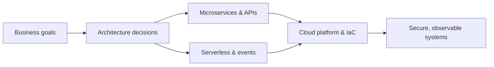

<!-- GitHub profile README for https://github.com/jhon192 -->
<!-- Designed to stand on its own: no website, CSS, JavaScript, or additional files required. -->

<h1>Jhon E. Garc&iacute;a M.</h1>

<h3>Solutions Architect &nbsp;|&nbsp; Cloud Engineer &nbsp;|&nbsp; Technical Leader</h3>

<strong>Designing cloud systems that scale. Engineering for security, reliability, and real business impact.</strong>

  
  
  

  
  
  

---

### About me

I'm a **Solutions Architect and Cloud Engineer with 6+ years of experience** creating secure, scalable and cost-efficient solutions across **AWS and Azure**. My work brings together **cloud-native architecture, distributed systems, DevOps and security** - from technical strategy and architectural governance to hands-on implementation.

I enjoy turning complex requirements into clear architecture decisions, helping teams deliver systems that are easier to operate, evolve and scale.

### Selected impact

<table>
  <tr>
    <td width="50%" align="center">
      <h2>35% &#8595;</h2>
      <strong>Cloud infrastructure costs</strong> 
      Reduced through architecture optimization and right-sizing
    </td>
    <td width="50%" align="center">
      <h2>70% &#8595;</h2>
      <strong>Infrastructure provisioning time</strong> 
      Reduced through automation and infrastructure as code
    </td>
  </tr>
  <tr>
    <td width="50%" align="center">
      <h2>1M+</h2>
      <strong>Events processed daily</strong> 
      Event-driven architecture with 99.9% uptime
    </td>
    <td width="50%" align="center">
      <h2>40% &#8595;</h2>
      <strong>Deployment failures</strong> 
      Reduced by improving CI/CD and delivery practices
    </td>
  </tr>
</table>

### What I specialize in

- **Cloud architecture & governance:** AWS/Azure architecture, modernization, security reviews, technical roadmaps and architecture decision records (ADRs).
- **Distributed & cloud-native systems:** Microservices, serverless, event-driven patterns, API-first integration and multi-tenant SaaS.
- **Platform engineering:** Infrastructure as code, container orchestration, CI/CD, GitOps, observability and high availability.
- **Technical leadership:** Design reviews, architectural standards, cross-functional collaboration and mentoring engineers.

### My architecture mindset

### Technology toolkit

| Area | Stack |
| :-- | :-- |
| **Cloud & Infrastructure** |     |
| **Containers & Delivery** |     |
| **Backend & APIs** |     |
| **Data & Observability** |     |

Also experienced with AWS CDK, Ansible, Jenkins, Prometheus, Datadog, RabbitMQ, REST/GraphQL, PostgreSQL, MongoDB and cloud security controls.

### Certifications

  
  &nbsp;
  
  &nbsp;
  
  &nbsp;
  
  &nbsp;
  

<strong>AWS Cloud Practitioner &nbsp;&middot;&nbsp; Azure Fundamentals &nbsp;&middot;&nbsp; CompTIA CySA+ &nbsp;&middot;&nbsp; Cisco Ethical Hacker &nbsp;&middot;&nbsp; SFPC</strong>

  

Images link to the certification program descriptions, not personal credential verification pages.

---

<h3>Let's build something that lasts.</h3>

Cloud architecture &nbsp;&middot;&nbsp; Reliability &nbsp;&middot;&nbsp; Security &nbsp;&middot;&nbsp; Automation

  <a href="https://www.linkedin.com/in/jhon-emanuel-garcia-martinez/">LinkedIn</a>
  &nbsp;&bull;&nbsp;
  <a href="mailto:jhon19.2@outlook.com">Email</a>
  &nbsp;&bull;&nbsp;
  <a href="https://github.com/jhon192?tab=repositories">Repositories</a>

